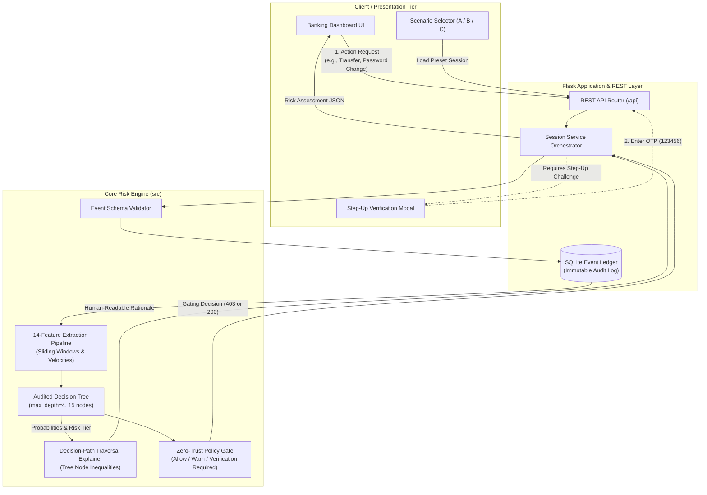

<div align="center">

# **Behavior-Based Session Risk Engine & Decision-Path Explainer**

[](https://www.python.org/)
[](https://flask.palletsprojects.com/)
[](https://scikit-learn.org/)
[](https://docs.pytest.org/)
[](LICENSE)
[]()

<p align="center">
  <strong>Dynamic, session-level risk prediction in a banking-grade environment — moving beyond crude one-off rule triggers and uninterpretable black-box neural networks.</strong>
</p>

[Key Features](#-key-features) •
[Interactive Demo Scenarios](#-interactive-demo-scenarios) •
[Architecture & Data Flow](#-system-architecture) •
[Feature Pipeline](#-behavioral-feature-engineering) •
[Model Evaluation & Benchmarks](#-model-benchmarks--evaluation) •
[API Reference](#-rest-api-reference) •
[Quickstart](#-quickstart--installation)

---

</div>

## 📌 Executive Overview

In online banking and security-critical systems, conventional fraud engines typically suffer from two extremes:
1. **Fragile Rule Systems:** Single anomalous events (e.g., one password typo or a travel IP) trigger false positives, causing user friction and checkout abandonment.
2. **Opaque Black-Box Models:** Deep networks produce risk probabilities without transparent explanations, making automated action blocking legally fraught and difficult for fraud analysts to audit.

**SentinelFlow** bridges this gap. It aggregates fine-grained, timestamped session interactions into a sliding temporal context, extracts deterministic behavioral signals (e.g., inter-login velocities, post-authentication credential change speed, and action bursts), and classifies the session risk tier using an **interpretable, audit-ready Decision Tree Classifier**.

Crucially, SentinelFlow provides **true white-box decision-path extraction**: rather than estimating importance through post-hoc sampling (like LIME or generic SHAP kernels), SentinelFlow translates the exact node-split traversal of the tree into plain-language explanations. High-risk sessions trigger a **backend-enforced Zero-Trust Policy Gate**, blocking sensitive operations until step-up multi-factor verification is completed.

---

## ✨ Key Features

- 🔍 **Explainable by Design (White-Box XAI)**
  Directly audits the traversed branch splits of an audited scikit-learn Decision Tree. Explanations correspond 1:1 with learned mathematical inequalities (e.g., *`login_failure_count (4.0) > 2.50`* and *`time_to_first_sensitive_action_sec (5.5s) <= 35.0s`*).
- 🛡️ **Backend-Enforced Zero-Trust Policy Gate**
  Sensitive operations (`password_change_requested`, `email_update_requested`) are strictly authorized by backend risk policy checks (`HTTP 403`), completely immune to client-side UI tampering.
- ⏱️ **Temporal & Behavioral Signal Fusion**
  Derives 14 behavioral metrics across sliding time windows: login burst velocity, session duration, action acceleration, and time-to-first-sensitive-action.
- 🎯 **High Precision & Zero False Positives on High Risk**
  Achieves a **Macro-F1 of 91.2%** (outperforming rule-based baselines at 87.5%) with a verified **0.0% False Positive Rate on High-Risk sessions** on held-out test evaluations.
- ⚡ **Sub-Millisecond Inference Latency**
  Zero external inference dependencies or GPU requirements. Live inference and decision-path generation execute in `< 0.1 ms` per session evaluation.
- 🔐 **Privacy-Conscious & Synthetic-First**
  Contains zero PII, zero real customer credentials, and avoids invasive hardware/biometric fingerprinting or unverified GPS claims.

---

## 🏛️ System Architecture

SentinelFlow employs a decoupled, modular pipeline separating event ingestion, feature computation, ML inference, explanation generation, and policy enforcement:



---

## 🎮 Interactive Demo Scenarios

The web interface (`http://127.0.0.1:5000`) provides three pre-configured scenarios illustrating how the engine responds to different behavioral profiles:

| Scenario | Behavioral Characteristics | Predicted Risk | Action Policy | System Behavior |
| :--- | :--- | :---: | :---: | :--- |
| **A: Routine Session** | Standard human pacing, familiar browser/device, viewing account balance and downloading statements. | `LOW` | **Allow** | All actions execute seamlessly. Probabilities heavily weight Low Risk (~95%+). |
| **B: Elevated Risk (ATO)** | Rapid login failure bursts (<1.5s interval), unfamiliar device, immediate password change request within seconds of login. | `HIGH` | **Verification Required** | Sensitive actions blocked (`403 Forbidden`). Dynamic Step-Up Verification Modal prompts for simulated OTP (`123456`). Upon verification, session unlocks. |
| **C: Ambiguous Telemetry** | Unfamiliar device flag present, but user pacing is normal, single login, and no credential change attempts. | `MEDIUM` / `LOW` | **Allow / Warn** | Demonstrates that unfamiliar device context alone does **not** falsely trigger a high-risk lockout. |

---

## 🔬 Behavioral Feature Engineering

All 14 features are extracted deterministically from timestamped event histories up to the moment of evaluation. Strict temporal ordering guarantees zero data leakage from future events:

| # | Feature Name | Type | Range | Description & Security Signal |
| :-: | :--- | :-: | :-: | :--- |
| **1** | `login_attempt_count` | `int` | $[0, \infty)$ | Total login attempts initiated in the session. |
| **2** | `login_failure_count` | `int` | $[0, \infty)$ | Cumulative failed password/credential attempts. |
| **3** | `login_failure_rate` | `float` | $[0.0, 1.0]$ | Ratio of failures to total attempts (signals brute-force attempts). |
| **4** | `median_login_interval_sec`| `float` | $[0.0, \infty)$ | Median spacing between attempts (sub-second spacing indicates automated tools). |
| **5** | `min_login_interval_sec` | `float` | $[0.0, \infty)$ | Minimum inter-attempt interval. |
| **6** | `session_duration_sec` | `float` | $[0.0, \infty)$ | Total elapsed session duration from initial event. |
| **7** | `sensitive_action_count` | `int` | $[0, \infty)$ | Frequency of credential or account configuration updates. |
| **8** | `time_to_first_sensitive_action_sec` | `float` | $[0.0, \infty)$ | Time from login success to first sensitive action (rapid changes signal account takeover). |
| **9** | `actions_last_60_sec` | `int` | $[0, \infty)$ | Sliding activity rate over the preceding 60 seconds. |
| **10** | `unfamiliar_device_flag` | `binary`| $\{0, 1\}$ | Simulated client environment familiarity marker. |
| **11** | `unusual_time_flag` | `binary`| $\{0, 1\}$ | Session initiation during anomalous off-peak hours (01:00–05:00 UTC). |
| **12** | `location_anomaly_flag` | `binary`| $\{0, 1\}$ | Simulated coarse geographic discrepancy flag. |
| **13** | `security_change_after_login_flag` | `binary`| $\{0, 1\}$ | Security change requested within 120s of initial login. |
| **14** | `action_burst_count` | `int` | $[0, \infty)$ | Maximum actions observed in any rolling 30-second window. |

---

## 📊 Model Benchmarks & Evaluation

The core model is an audited `DecisionTreeClassifier` with `max_depth=4` and `min_samples_leaf=8` to guarantee human auditability and prevent over-fitting.

### Held-Out Test Evaluation ($N = 180$)

Evaluated on stratified synthetic sessions comparing the trained Decision Tree against a transparent heuristic rule-based baseline:

| Metric | SentinelFlow (Decision Tree) | Rule-Based Baseline | Delta |
| :--- | :---: | :---: | :---: |
| **Macro F1-Score** | **91.17%** | 87.45% | **+ 3.72%** |
| **Balanced Accuracy** | **91.36%** | 90.00% | **+ 1.36%** |
| **High-Risk False Positive Rate** | **0.00%** | **0.00%** | Stable |
| **High-Risk Recall** | **100.00%** | 100.00% | Optimal |
| **Medium-Risk F1** | **83.64%** | 80.00% | **+ 3.64%** |
| **Low-Risk F1** | **89.89%** | 82.35% | **+ 7.54%** |
| **Average Inference Latency** | **< 0.1 ms** | < 0.1 ms | Real-Time |

### Confusion Matrix (Test Set)

```text
               Predicted Low   Predicted Med   Predicted High
Actual Low          80              10               0
Actual Med           8              46               0
Actual High          0               0              36
```
> **Key Safety Property:** High-risk sessions are never misclassified as low risk, and legitimate (low/medium) sessions are never mislabeled as high risk (0% High-Risk FPR).

---

## 🔍 White-Box Decision-Path Explanations

Rather than generating post-hoc surrogate estimates, SentinelFlow reconstructs the exact tree traversal path. Here is an example of the explanation object produced for an elevated-risk session:

```json
{
  "predicted_risk": "high",
  "probabilities": { "low": 0.0, "medium": 0.0, "high": 1.0 },
  "explanation": {
    "summary": "Session classified as HIGH RISK based on 2 decisive decision tree conditions.",
    "decision_path": [
      {
        "step": 1,
        "feature": "login_failure_count",
        "condition": "> 2.50",
        "observed_value": 4.0,
        "description": "login_failure_count (observed 4.0) exceeded learned threshold of 2.50"
      },
      {
        "step": 2,
        "feature": "time_to_first_sensitive_action_sec",
        "condition": "<= 35.00",
        "observed_value": 5.5,
        "description": "time_to_first_sensitive_action_sec (observed 5.5s) was <= learned threshold of 35.0s"
      }
    ],
    "contextual_notes": [
      "Unfamiliar device flagged in session telemetry."
    ]
  }
}
```

---

## 🚀 Quickstart & Installation

### 1. Prerequisites
- Python `3.10` or higher
- Git

### 2. Clone Repository & Setup Virtual Environment
```bash
# Clone the repository
git clone https://github.com/hriday2706/SentinelFlow.git
cd "SentinelFlow"

# Create and activate virtual environment
python -m venv venv

# On Windows (PowerShell):
.\venv\Scripts\Activate.ps1
# On macOS / Linux:
source venv/bin/activate

# Install dependencies
pip install -r requirements.txt
```

### 3. Run Automated Test Suite
Verify that all 28 unit and integration tests pass:
```bash
pytest -v
```

### 4. Start the Application
```bash
python main.py
# or: python app.py
```
Open your browser and navigate to:
👉 **`http://127.0.0.1:5000`**

---

## 🔌 REST API Reference

| Method | Endpoint | Description | Sample Request / Response |
| :--- | :--- | :--- | :--- |
| `GET` | `/api/health` | Health check and engine versioning. | `{"status": "healthy", "version": "1.0.0-hackathon-poc"}` |
| `POST`| `/api/demo/login` | Initialize or simulate a user session. | `{"username": "alex", "device_familiarity": "familiar"}` |
| `GET` | `/api/session/current` | Active session metadata & audit event timeline. | Returns current session ID, balance, and event history. |
| `GET` | `/api/risk/current` | Real-time risk prediction & explanation. | Returns risk tier, probabilities, and tree traversal path. |
| `POST`| `/api/events` | Ingest arbitrary validated session event. | `{"event_type": "balance_viewed", "success": true}` |
| `POST`| `/api/actions/balance` | Simulate non-sensitive balance lookup. | Allowed under all risk categories. |
| `POST`| `/api/actions/statement` | Simulate statement download. | Allowed under all risk categories. |
| `POST`| `/api/actions/security-change` | Trigger sensitive credential update. | **Gated:** Returns `403 Blocked` if session is High Risk and unverified. |
| `POST`| `/api/verification/request` | Request simulated step-up OTP challenge. | Returns challenge ID and prompt. |
| `POST`| `/api/verification/complete` | Complete verification challenge. | `{"code": "123456"}` → Unlocks session to `VERIFIED`. |
| `POST`| `/api/demo/load-scenario` | Load predefined scenario (`A`, `B`, or `C`). | `{"scenario": "B"}` |
| `GET` | `/api/model/info` | Inspect model metadata & test metrics. | Returns parameters, feature names, and confusion matrices. |

---

## 📂 Project Structure

```text
SentinelFlow/
├── backend/
│   ├── database.py              # SQLite event store & schema initialization
│   ├── routes.py                # Flask REST API blueprint endpoints
│   └── services.py              # Session management, verification & policy gating
├── data/
│   ├── README.md                # Data documentation & synthetic generation notes
│   └── synthetic_sessions.csv   # 1,019 stratified session records for training & test
├── docs/
│   ├── data_card.md             # Dataset documentation, generation rules & distributions
│   ├── demo_script.md           # Step-by-step hackathon presentation & walkthrough script
│   ├── feature_dictionary.md    # Formal mathematical definitions of all 14 features
│   ├── labeling_policy.md       # Ground-truth labeling definitions & ethical guidelines
│   └── model_card.md            # Model architecture, hyperparameters, and held-out metrics
├── frontend/
│   ├── app.js                   # Reactive UI controller, timeline renderer & API client
│   ├── index.html               # Responsive banking dashboard layout & modals
│   └── styles.css               # Clean, modern design system
├── models/
│   ├── decision_tree.joblib     # Serialized trained scikit-learn Decision Tree model
│   └── model_metadata.json      # Model hyperparameters, feature list & held-out metrics
├── src/
│   ├── data_generation.py       # Deterministic synthetic session generator
│   ├── evaluate_model.py        # Independent evaluation & baseline comparison script
│   ├── event_schema.py          # Pydantic-style validated event models & enums
│   ├── explanations.py          # White-box tree traversal to natural language translator
│   ├── feature_extraction.py    # Pure, leak-free session-to-features extraction logic
│   ├── inference.py             # Inference pipeline with probability calibration
│   ├── risk_policy.py           # Zero-Trust policy gate & step-up action logic
│   └── train_model.py           # Training pipeline with stratified train/test split
├── tests/
│   ├── test_api.py              # Integration tests for Flask REST endpoints
│   ├── test_event_schema.py     # Schema validation and timestamp parsing tests
│   ├── test_explanations.py     # Decision-path translation unit tests
│   ├── test_feature_extraction.py # 14-feature deterministic computation tests
│   ├── test_health.py           # Health endpoint verification
│   ├── test_model_inference.py  # Inference pipeline & probability checks
│   └── test_risk_policy.py      # Sensitive action gating & step-up verification tests
├── app.py                       # Flask application factory
├── config.py                    # Global configuration & absolute path resolutions
├── LICENSE                      # MIT Open Source License
├── main.py                      # Standalone server entry point
├── requirements.txt             # Python dependencies
└── README.md                    # Comprehensive project documentation
```

---

## 🛠️ Model Training & Data Generation

To regenerate synthetic training data or retrain the decision tree model:

```bash
# 1. Generate 1,000+ stratified synthetic sessions
python src/data_generation.py

# 2. Train the explainable Decision Tree and serialize artifacts
python src/train_model.py

# 3. Run held-out evaluation and print confusion matrix
python src/evaluate_model.py
```

---

## 🔒 Privacy, Security & Responsible AI

- **Synthetic Only:** All data, accounts, balances, and event streams are synthetically generated for demonstration purposes. No real banking infrastructure, credentials, or customer PII are utilized.
- **No Hardware Fingerprinting:** SentinelFlow intentionally avoids intrusive hardware telemetry, canvas fingerprinting, or dubious IP-to-physical-geolocation claims.
- **Fail-Safe Security:** In unverified high-risk sessions, sensitive financial and credential operations fail closed at the server level, requiring explicit out-of-band verification.
- **Fairness & Auditability:** By restricting tree depth and documenting every branch split, security operations teams can inspect and dispute every automated decision.

---

## 📄 License

This project is licensed under the terms of the [MIT License](LICENSE).

---

<div align="center">
  <sub>Built with precision for explainable, high-trust AI systems.</sub>
</div>
